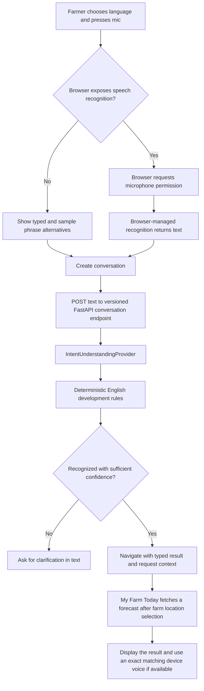

# Kisan Hita voice foundation (Stage 2)

## Status and limits

This document records the Stage 2 voice foundation. Stage 3 now implements My Farm Today; the other four routes remain placeholders. Voice routing still uses a small set of English keyword rules, not an LLM or reliable natural-language understanding. Do not use its confidence as a production safety decision.

No Gnani SDK, credential, provider, or network request is configured. Voice providers use local `mock` adapters. Weather separately selects Open-Meteo at runtime or the fictional `mock` adapter; no paid provider fallback exists.

## Request flow



## Backend contracts

All routes use the existing configurable API version prefix (default `/api/v1`).

| Method and path | Purpose |
| --- | --- |
| `POST /voice/conversations` | Create an in-memory session and preserve the requested language tag. |
| `POST /voice/conversations/{id}/messages` | Send recognized or typed text to the injected intent-understanding provider. Returns intent, destination, entities, confidence, clarification flag, and explicit placeholder status. |
| `PUT /voice/conversations/{id}/farm-location` | Save the farmer-selected state and district in the in-memory voice session. |
| `POST /voice/conversations/{id}/audio` | Accepts WebM/WAV/Ogg/MP4/MPEG bytes within `MAX_UPLOAD_BYTES`, then calls the selected `SpeechToTextProvider` with the bytes and metadata. The current mock ignores the bytes and returns no transcript. |
| `POST /voice/conversations/{id}/speech` | Send response text to the selected `TextToSpeechProvider` using the conversation language. The current mock returns `available: false` and no audio payload. |

Conversation state is process-local and contains language, last intent, turn count, and selected state/district. It is cleared on backend restart and is not durable. Audio and message text are not retained by the session service. The browser frontend currently uses browser recognition and sends only recognized text to the message endpoint; the audio endpoint is a future provider integration seam.

## Provider boundaries and switching

- `SpeechToTextProvider`, `IntentUnderstandingProvider`, and `TextToSpeechProvider` are backend protocols in `backend/app/providers/interfaces.py`.
- `DeterministicIntentProvider` and the explicit non-processing speech mocks live in `backend/app/providers/mock.py`.
- `backend/app/services/container.py` constructs adapters once and injects them into services. Intent selection uses `INTENT_PROVIDER`; the existing STT/TTS selectors are `SPEECH_TO_TEXT_PROVIDER` and `TEXT_TO_SPEECH_PROVIDER`. All default to `mock`. An unregistered name fails during app startup; no implicit fallback occurs.
- To add Gnani later, implement one adapter per capability conforming to these protocols, register its factory under an explicit provider name, and configure the corresponding backend-only environment variable. Add adapter contract tests against the same Pydantic response types. Keep credentials server-side, leave `mock` as the default, and do not add frontend provider-specific code. Compatibility tests should verify provider errors, languages, uncertainty, and response shapes before changing deployment configuration. No Gnani integration is present or activated now.

The speech provider models define response shapes and explicit mock behavior. The audio endpoint invokes the configured STT adapter. The TTS mock reports unavailable; the frontend may use a device/browser voice only when an exact language tag is present. If no exact voice is found, it displays the text response without pretending speech was produced.

## Browser behavior, privacy, and language status

The running Chrome page exposed `SpeechRecognition` or its WebKit-prefixed form because the app did not display its unsupported-browser notice. The microphone permission prompt was not opened and no audio recognition was performed during development. Only the user’s mic-button press calls the browser recognition API, and the app currently gates that action to English because other languages are unverified. The Web Speech recognition implementation is managed by the browser/operating system and may send audio to a service outside Kisan Hita; the page says so before use. The actual destination and retention are governed by that browser/device, not this backend. Browser support and availability vary.

The page lists Telugu, Hindi, Tamil, Malayalam, Kannada, Marathi, and English. All are marked unverified; no end-to-end STT, intent, or TTS language has been verified. The current deterministic intent rules only recognize a limited set of English phrases. Mic use is gated to English until other speech support is verified. Text requests in another selected language get an explicit English limitation notice; the API preserves both the selected conversation language and response language. Browser speech synthesis is attempted only with a device voice whose language exactly matches the session tag; voice availability is platform dependent.

The backend audio endpoint passes request bytes to the selected STT adapter in memory, imposes a size limit, and does not write files. The present mock ignores the bytes, does not call an external service, and returns no transcript. Do not submit sensitive recordings to browser speech unless the user understands the browser/device privacy implications.

## Lifecycle and interface

The home component represents idle, permission request, listening, waiting for the farmer to finish, recognition completion, understanding, feature routing, processing, speaking on the destination screen, and error states. Browser interim results update only the on-screen transcript; only final segments enter the utterance buffer. The utterance is submitted after a configurable silence interval (`VITE_VOICE_END_SILENCE_MS`, default 3500 ms, clamped between 1500 and 10000 ms) or when the farmer presses **Finish speaking**. Both paths stop recognition and wait for its `onend`; an unexpected end or an empty final transcript never routes. Final segments are retained by result index so later recognition events do not duplicate or erase earlier segments. Cancel aborts without submission. Permission prompts are initiated only by a user gesture. Stop request cancels an in-flight message request and device speech where supported. Errors include unsupported recognition, permission denial, no speech, backend unavailability, and provider/route errors. Typed requests and clearly labeled sample phrases are available when voice is unsupported.

The five destinations remain visible in the existing feature navigation. A successful deterministic route navigates to the matching route with the complete request and structured result in router state. My Farm Today fetches the configured weather source after location selection; the other four destinations show a clear not-implemented state. A weather safety question requests crop, stage, and product details rather than making a product-specific claim.

## Local development

From the project root:

```sh
cd backend
.venv/bin/uvicorn app.main:app --reload --port 8000
```

In another terminal:

```sh
cd frontend
npm run dev
```

The frontend API base defaults to `http://localhost:8000/api/v1`; set `VITE_API_BASE_URL` at frontend build time when the backend is elsewhere. Backend CORS origins remain controlled by `FRONTEND_ORIGINS`.

Tests use deterministic providers and do not require network access, microphone permission, or credentials. The frontend sample buttons send ordinary text fixtures, not audio.
